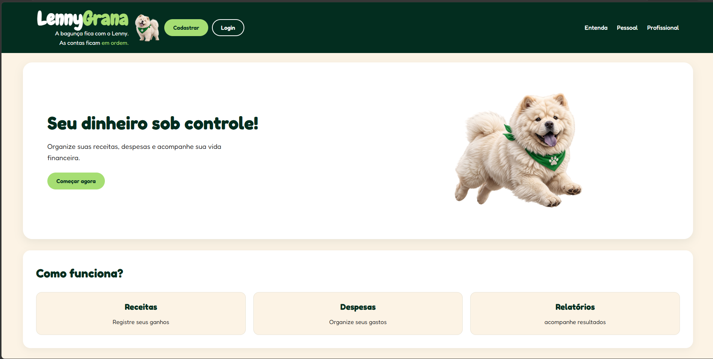

# 🐶Lenny Grana

**A bagunça fica com o Lenny. As contas ficam em ordem.**

    O Lenny Grana é um projeto de aplicação web voltado para organização e controle financeiro pessoal.
    O objetivo é oferecer uma ferramenta simples, intuitiva e acessível para facilitar o gerenciamento de receitas, despesas e planejamento financeiro.
    A aplicação também tem como proposta atender profissionais autônomos, permitindo acompanhar ganhos, gastos e resultados financeiros de suas atividades.

---

## 📸 Demonstração do projeto 

### Página inicial


### Página de cadastro


---
## 📌 Progresso do desenvolvimento

### ✅ interface

- [x] Estrutura HTML da página inicial.
- [x] Estilização CSS da página inicial.
- [x] Estrutura HTML da página de cadastro.
- [ ] Estilização CSS da página de cadastro.

### 🚀 Funcionalidades

- [ ] Sistema de cadastro de usuários.
- [ ] Sistema de login.
- [ ] Recuperação de senha.
- [ ] Cadastro e gerenciamento de receitas.
- [ ] Cadastro e gerenciamento de despesas.
- [ ] Organização de despesas por categorias.
- [ ] Histórico de lançamentos financeiros.
- [ ] Resumo financeiro.
- [ ] Relatórios financeiros.
- [ ] Controle financeiro para profissionais autônomos.

---

## 🛠️ Tecnologias utilizadas

As seguintes tecnologias estão sendo utilizadas no desenvolvimento do projeto:

- **HTML5:** Estruturação e organização do conteúdo das páginas.
- **CSS3:** Estilização, identidade visual e responsividade da interface.

### Tecnologias previstas

Conforme o desenvolvimento avançar, serão incorporadas novas tecnologias:

- **JavaScript:** Implementação de interatividade e funcionalidades no front-end.
- **PHP:** Desenvolvimento da lógica e processamento no back-end.
- **MySQL:** Gerenciamento e armazenamento dos dados da aplicação.

--- 

## 💻 Como executar o projeto

### Pré-requisitos

- Navegador web atualizado.
- Git instalado (Opcional, caso queira clonar o repositório).
- Visual Studio Code (recomendado).

### Instalação

1. Clone o repositório:

    ````bash
    git clone https://github.com/adrivancabral/ProjetoFinanceiro.git
    ````

2. Acesse a pasta do projeto:

    ````bash 
    cd "ProjetoFinanceiro"
    ````

3. Abra a pasta no Visual Studio Code.

4. Execute o arquivo "index.html" no navegador ou utilize a extensão do Live Server.

--- 

## 📂 Estrutura de diretórios

O projeto está organizado da seguinte forma:

```text
Lenny Grana/
│
├── cadastro.html
├── index.html
├── README.md
│
├── css/
│   ├── cadastro.css
│   └── style.css
│
├── imagens/
│   ├── LennyCorrendo.png
│   ├── LennyCorrendo500px.png
│   ├── LennyCorrendoTeste.jfif
│   ├── Lennypng.png
│   ├── Lennypng400px.png
│   └── Lennypng400px.xcf
│
└── js/
    └── cadastro.js
```

### Organização dos arquivos 

- **Arquivos HTML:** Ficam na raiz do projeto, responsáveis pela estrutura das páginas.
    - `index.html`: página inicial.
    - `cadastro.html`: página de cadastro.

- **CSS:** contém os arquivos responsáveis pela estilização das páginas.
    - `style.css`: estilização da página inicial.
    - `cadastro.css`: estilização da página de cadastro.

- **Imagens:** armazena os recursos visuais utilizados no projeto, incluindo as imagens do mascote Lenny.

- **JavaScript:** contém os arquivos destinados à implementação de interatividade e funcionalidades.
    - `cadastro.js`: arquivo JavaScript destinado à página de cadastro.

---

## 📌 Status do projeto

🚧 Em desenvolvimento.

Atualmente, o projeto conta com:

- Página inicial desenvolvida em HTML5 e CSS3.
- Página de cadastro com estrutura HTML implementada.
- Organização inicial dos diretórios e arquivos do projeto.

O desenvolvimento está sendo realizado por etapas, começando pela construção da interface e avançando para a implementação das funcionalidades e integração com back-end.

---

## 👨‍💻 Autor 

**Adrivan de Azevedo Santos Cabral**

Estudante de Análise e Desenvolvimento de Sistemas.

- GitHub: [@adrivancabral](https://github.com/adrivancabral)
- LinkedIn: [Adrivan de Azevedo Santos Cabral](https://www.linkedin.com/in/adrivan-de-azevedo-santos-cabral-746ba2222/) 